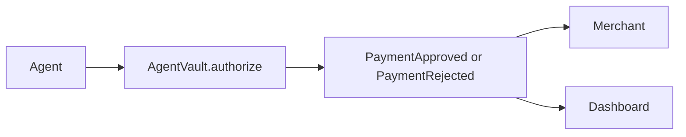

# AgentPay

AgentPay is an on-chain spending policy for AI agents on Monad testnet. The owner sets a per-payment cap, a daily budget, and an allowlist of merchants. The agent calls `authorize`. The contract records `PaymentApproved` or `PaymentRejected` with a reason. No funds move. A merchant trusts the event, not the agent.

## Problem and solution

An agent that can spend needs a rule the merchant can check without trusting the agent process. AgentPay puts those rules in `AgentVault`. A rejected call does not revert: the contract emits `PaymentRejected` and leaves the payment reference unused, so the same reference can be retried after the owner fixes the rule. An approval marks the reference used and counts the amount against today's budget.

## Architecture



## Live app

https://agentpay-nine-eta.vercel.app

## Contract

| | |
| --- | --- |
| Network | Monad Testnet, chain id 10143 |
| AgentVault | [`0xc5ae4a94Ba0f6EFa342a1B130ea54a74f9D20aFd`](https://testnet.monadvision.com/address/0xc5ae4a94Ba0f6EFa342a1B130ea54a74f9D20aFd) |
| Deploy block | 69775608 |
| Monadscan | [`0xc5ae4a94Ba0f6EFa342a1B130ea54a74f9D20aFd`](https://testnet.monadscan.com/address/0xc5ae4a94Ba0f6EFa342a1B130ea54a74f9D20aFd) |

Source verification is not submitted yet. From `contracts/`, the MonadVision command is in `contracts/DEPLOY.md`:

```powershell
forge verify-contract 0xc5ae4a94Ba0f6EFa342a1B130ea54a74f9D20aFd src/AgentVault.sol:AgentVault --chain 10143 --verifier sourcify --verifier-url https://sourcify-api-monad.blockvision.org/
```

After that succeeds, the verified source is on the MonadVision address page linked above.

The deploy set one agent at `0x26C1823148d5e2369E8F5240b5A2d006387c6855` with a 0.5 MON per-payment cap and a 2 MON daily budget, and approved merchant `0x25C5c284A48d299119400F6DbDD07A54F86C18Ef`.

## Rules

`authorize` checks in this order. A failed check emits `PaymentRejected` and returns false. Caps use `>`, so an amount equal to the cap is allowed.

| Reason | When it happens |
| --- | --- |
| `AGENT_REVOKED` | The agent was never set, or the owner revoked it. |
| `REF_ALREADY_USED` | This `bytes32` reference was already approved. |
| `MERCHANT_NOT_ALLOWED` | The merchant is not on the allowlist. |
| `OVER_PER_TX_CAP` | The amount is above the per-payment cap. |
| `OVER_DAILY_CAP` | The amount would exceed the remaining daily budget. |

The daily window resets when `block.timestamp` reaches `windowStart + 1 days`. `remainingToday` is a view. Amounts are wei, 18 decimals.

## Run it yourself

1. Install [Foundry](https://getfoundry.sh/) 1.8 or newer. Monad's current docs use that official release with `network = "monad"` in `foundry.toml`, which this repo already sets. The older Monad installer is `foundryup --network monad`.
2. Clone this repo and get test MON from https://faucet.monad.xyz for the deployer. Send a little MON to the agent address too. It pays gas. The vault does not hold funds.
3. In `contracts/`, copy `.env.example` to `.env`. Set `PRIVATE_KEY`, `AGENT_ADDRESS`, and `MERCHANT_ADDRESS`. Use a throwaway testnet key. Do not commit `.env`.
4. Deploy, from `contracts/`:

```powershell
forge script script/Deploy.s.sol:Deploy --rpc-url https://testnet-rpc.monad.xyz
forge script script/Deploy.s.sol:Deploy --rpc-url https://testnet-rpc.monad.xyz --broadcast
```

The first command is a dry run. Details, the deploy block, and verification are in `contracts/DEPLOY.md`.

5. In `web/`, copy `.env.example` to `.env.local` and set the vault address and deploy block. Then:

```powershell
npm install
npm run dev
```

6. In `tools/`, follow `tools/README.md` and run:

```powershell
npx tsx simulate.ts approve
npx tsx simulate.ts over-cap
npx tsx simulate.ts bad-merchant
```

## Limitations

AgentPay is an authorization layer. It does not escrow, settle, or move MON. It is deployed on Monad testnet only, it is unaudited, and the AI agent that will call `authorize` is planned and is not in this repo.

## Roadmap

- Settle an approved payment with x402 or stablecoins.
- Hold funds in escrow until the merchant confirms.
- Connect an AI agent that requests `authorize` under the owner's rules.
